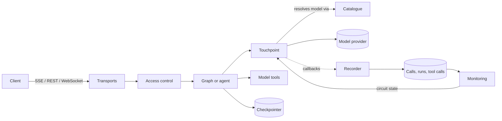

# django-llm-kit

Use LangGraph and LangChain in Django the Django way. Declare your models, agents and tools in code; llm-kit gives you the database storage, the HTTP and WebSocket endpoints, the admin screens, and a record of every call and what it cost.

```
pip install "django-llm-kit[all]"
```

## What you get

| Feature | In one line | Guide |
|---|---|---|
| **Graphs** | Register a LangGraph graph by dotted path; it is compiled with a checkpointer and served over SSE, REST and WebSocket. | [Graphs](guides/graphs.md) |
| **Touchpoints** | Each place your code calls a model declares its default, fallbacks, required capabilities and who may pick the model. Admins can narrow it without a deploy. | [Touchpoints](guides/touchpoints.md) |
| **Agents and subagents** | One harness runs every agent; a subagent is the same harness with another model, prompt and tools. | [Agents](guides/agents.md) |
| **Tools from your models** | Declare what agents may see on a Django model; llm-kit generates find/save tools limited to the caller's rows, with approvals. | [Model tools](guides/tools.md) |
| **Model catalogue** | Prices, limits and capabilities for about 12,600 models from models.dev, OpenRouter and LiteLLM. | [Catalogue](guides/catalogue.md) |
| **Observability** | Every model call, tool call and run recorded: tokens, cost, latency, fallbacks, classified errors. | [Observability](guides/observability.md) |
| **Monitoring** | Query functions, JSON API, admin dashboard, circuit breaker, alerts, Prometheus. | [Monitoring](guides/monitoring.md) |
| **Checkpointer** | `DjangoSaver` stores graph state in your database; or use LangGraph's `PostgresSaver` or your own. | [Checkpointers](guides/checkpointer.md) |
| **Streaming and APIs** | Async SSE views, a DRF API, and a Channels consumer, all with the same payload and events. | [Streaming and APIs](guides/streaming.md) |
| **Access control** | Threads belong to a user, a visitor, a key your code chose, or nobody; tenants are isolated. | [Access control](guides/access.md) |

## How it fits together



Everything model-related goes through a **touchpoint**, so every call is checked against the catalogue, can fall back to another provider, and is recorded. The `llm_kit.core` package holds this logic without importing Django; the rest of the package adapts it to Django's settings, ORM, admin and views.

## Requirements

- Python 3.11+
- Django 5.0+ (5.1+ recommended for SQLite's `transaction_mode`)
- LangGraph 1.0+ and LangChain 1.0+
- An ASGI server (Daphne, Uvicorn) for streaming. Under WSGI the SSE views work, but buffer the whole reply.

## For AI assistants

Every page of these docs is also published as plain Markdown: add `.md` to a page's path (for example [`guides/agents.md`](https://teklora-solutions.github.io/django-llm-kit/guides/agents.md)). [`llms.txt`](https://teklora-solutions.github.io/django-llm-kit/llms.txt) lists all pages with a one-line summary, and [`llms-full.txt`](https://teklora-solutions.github.io/django-llm-kit/llms-full.txt) holds the whole documentation in one file.

## Next

Start with [Getting started](getting-started.md).
